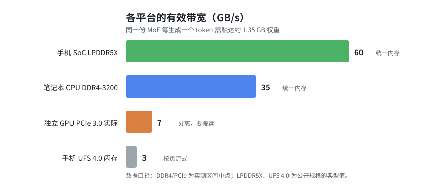
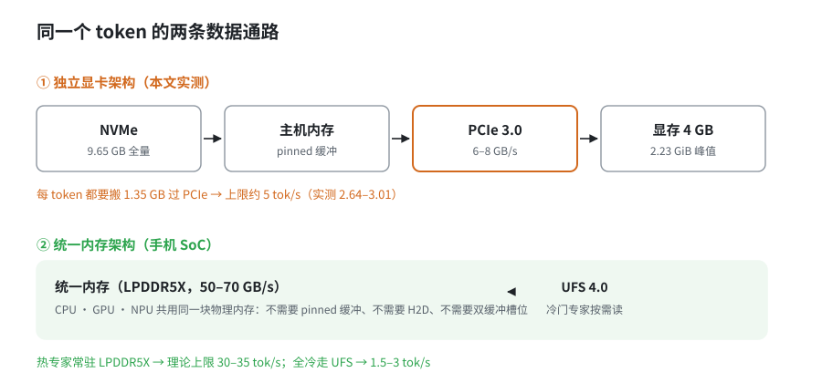
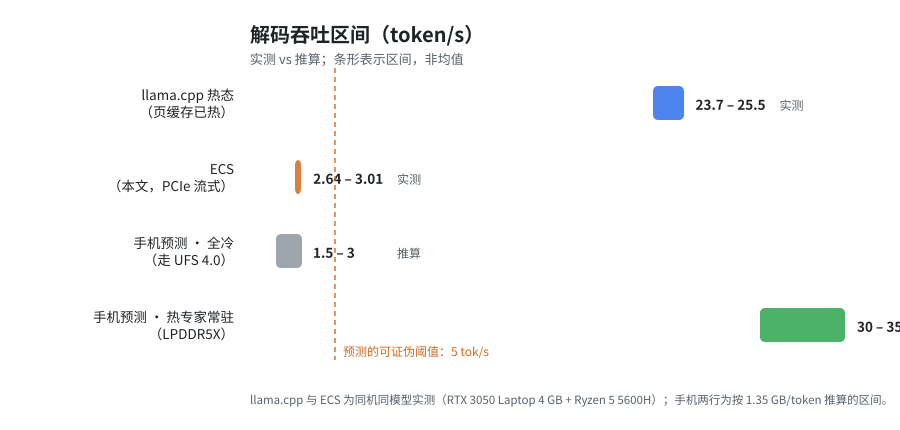

# 4GB 显存的游戏本，跑起了 15.7B 的模型

> 从一张笔记本显卡到一个五年期的可证伪预测

---

## 一、先说做成了什么

我做了一个叫 ECS 的东西（Expert Coordination System），起点是一台 4GB 显存的游戏本。

下面四件事，都是实测的：

**1. 15.7B 的 MoE，在 4GB 显存上跑完了。**

模型是 DeepSeek-V2-Lite，量化文件 9.65 GiB。**峰值显存 2.23 GiB**，解码 2.6–3.0 tok/s，
输出 token 与单卡基线逐位一致。不是勉强加载，是完整推理。

**2. 同一张卡上，Qwen2.5-3B 跑到 42.7 tok/s。**

7B 混合精度（4bit attention + 3bit MLP）跑到 **26 tok/s**，占 3.20 GiB。
在 4GB 这个前提下，这两个数字本身就该被单独拿出来说。

**3. 双卡扩展是 token 精确的。**

8 个并发请求，聚合 **25.90 tok/s**，单卡的 **6.17 倍**。
远端那张卡不加载 transformer，峰值只占 **38 MiB**。
单卡/双卡、paged/dense、静态/动态——**所有路径输出完全一致**。

**4. 前缀共享砍掉 26%。**

4 个请求共享 89-token 前置说明：wall 8.36 s → **6.15 s**，单请求 prefill 1.17 s → **0.55 s**。

127 个单元测试全绿，全部路径 token 精确，每次运行 KV 池完整归还。

**这些是怎么做到的，才是这篇文章想讲的。**

---

## 二、四层同时重构

MoE 的卖点是"参数量大、激活量小"。但要在 4GB 上兑现它，得在四个层面同时动手，
少一层就 OOM 或者慢到不可用。

**权重供给：分层存储 + 专家粒度流式**

三级存储：L1 显存 / L2 内存（pinned）/ L3 NVMe。粒度是 **expert chunk**（每块最多 8 个专家），
不是整层、不是整模型。整层 offload 实测只能到 1.86 tok/s，专家粒度加冷热切分能到 2.50。

关键的一步是 **fused kernel 直接吃 packed 权重**：Q4_K / Q5_0 / Q8_0 不再反量化展开成 FP16，
省掉"解量化 → 写 HBM → 再读回来"的往返。这是从"能跑"到"能用"的分界线。

**KV 管理：paged + 前缀共享**

每个请求持有自己的 block 列表，按需逐块增长——17-token 的 prompt 不会占住 128 token 的容量。
decode 每步只重建一张 `[batch, max_blocks]` block table，**行永远不搬动**。

前缀共享按 block 做累积 hash，命中就 retain，只算剩余后缀。
有个不显眼但必须做对的约束：**block 对齐的 prompt 绝不交还最后一块**——那一块还要写本行尾部。

**请求调度：连续批处理**

请求动态进出空槽，chunked prefill 与 batched decode 交替。
另外加了一个 admission grace 窗口：空闲期等一小段，把一串到达合并成一次 prefill。
（一次 17-token prefill 在双卡上约 0.86 s，八次单独 admission 就要付八次。）

**跨设备：专家分片**

协调卡保留 attention + 共享专家 + LM head，第二张卡只当专家执行器。
NCCL 点对点交换激活值。

---

## 三、然后是必须说的那一半：我输了 8 倍

做完这些，我做了件很多人不会做的事：**在同一台机器上，拿 llama.cpp 跑同一个模型做对照。**

| | llama.cpp（纯 CPU） | 我的 ECS |
|---|---:|---:|
| 稳态解码 | **23.7–25.5 tok/s** | 2.64–3.01 tok/s |
| 峰值内存 | 5.37 GiB | **3.00 GiB** |
| 峰值显存 | **386 MiB** | 2.23 GiB |

**它比我快 8–9 倍。** 但也有一个数字是我们赢的：**常驻内存 3.00 vs 5.37 GiB，省 44%**。

那一刻我的第一反应是"哪里没调好"。把账算完，发现不是调优问题。

---

## 四、那 8 倍输在哪：每生成一个 token 要搬 1.35 GB

DeepSeek-V2-Lite 总参数 15.7B，每 token 激活约 2.4B。Q4_K_M 约 4.5 bit/参数：

```
每 token 触达的权重 ≈ 2.4e9 × 4.5/8 ≈ 1.35 GB
```

这是 MoE 的魅力：不用读 9.65 GB，只读 1.35 GB。但"读"的代价取决于硬件。

**llama.cpp：** mmap 映射整个文件，CPU 直接从 DDR4 读。

```
1.35 GB/token × 25 tok/s ≈ 34 GB/s
```

Ryzen 5 5600H 双通道 DDR4-3200，实际 30–40 GB/s。**它已经贴着内存带宽墙在跑。**

**ECS：** NVMe → pinned 内存 → PCIe → 显存。

```
1.35 GB/token × 2.8 tok/s ≈ 3.8 GB/s
```

PCIe 3.0 实际 6–8 GB/s。**我们也已经用掉一半了。**

要在 PCIe 上跑到 25 tok/s，需要 34 GB/s 的 PCIe——**不存在。**

这不是优化能解决的问题，是把 34 GB/s 的水往 8 GB/s 的管子里灌。

---

## 五、这笔"过路费"是谁收的

> llama.cpp 不付过路费，我们要付。

收钱的是**独立显卡这个架构本身**。笔记本上有两块物理上分开的内存，中间只有一条 PCIe。
任何参与 GPU 计算的数据都得过这条总线。

MoE 的稀疏性在这里变成了诅咒：它让你"不用加载全部权重"，同时让"每次换专家都要搬一遍"成为常态。
**省下的是存储，付出的是带宽。**

| 平台 | 计算单元和内存的关系 | 有效带宽 | 要不要搬权重 |
|---|---|---:|---|
| 笔记本 + 独立 GPU | 分离，过 PCIe | 6–8 GB/s | **要** |
| 笔记本 + CPU | 统一 | 30–40 GB/s | 不要 |
| 手机 SoC（LPDDR5X） | **统一** | 50–70 GB/s | 不要 |
| 手机 + UFS 4.0 闪存 | — | 2–4 GB/s | 不要（按页流式） |



**我们要付的那笔过路费，在手机上根本不存在。**



---

## 六、于是认真算了一遍手机

手机不是"带宽更大所以更快"这么简单，它有两个更彻底的好处。

**好处一：没有搬运。** CPU、GPU、NPU 看的是同一块物理内存。
我为对付 PCIe 写的一大堆东西——pinned 缓冲、双缓冲槽位、异步拷贝流、跨流事件同步——**全部不需要**。
这些在 ECS 里占了相当一部分复杂度，而且每一个都是 bug 的温床。

**好处二：显存不再是墙。** 原来的问题是"9.65 GB 怎么塞进 4GB"。
在 16 GB 统一内存的手机上，这个问题不存在。剩下的只是"能不能算得够快"。

还是用 1.35 GB/token 这个口径：

```
情况 A（热专家常驻 LPDDR5X）：50 GB/s ÷ 1.35 GB ≈ 37 tok/s 理论上限，30–35 是合理区间
情况 B（全部走 UFS 4.0）：    2–4 GB/s ÷ 1.35 GB ≈ 1.5–3 tok/s
```

**情况 B 的 1.5–3 tok/s，和我们今天在 PCIe 上实测到的 2.6–3.0 tok/s 完全同一水平**——
区别只是：那次我们在受 4GB 显存的折磨，这次受闪存速度的折磨。

真实位置由专家热度分布决定。而"利用热度做分级缓存"，正是 ECS 已经实现的那部分
（L1 显存 / L2 内存 / L3 闪存 + LRU）：

> 把同一套架构从"独立显卡 + PCIe"搬到"统一内存 SoC"，
> 限制它的那项物理约束会消失，而它本来要解决的问题恰好是手机上最值钱的问题。

---

## 七、硬件其实已经到位

这不是路线图，是已经量产的东西：

- 旗舰手机内存：**12–16 GB LPDDR5X**，带宽 50–70 GB/s
- 存储：**256 GB – 1 TB UFS 4.0**，顺序读 3–4 GB/s
- DeepSeek-V2-Lite Q4_K_M：**9.65 GB**

一个 16 GB + 512 GB 的手机，容量装得下，带宽刚好落在"能用"的区间。
缺的不是硬件，是软件栈——今天多数移动推理框架假设"完整加载进内存然后算"，
这在 10 GB 级 MoE 上必须换成按专家流式供给 + 分级缓存 + 热度调度。

---

## 八、预测，以及它可以怎么被打脸

> **五年内，一部 16 GB 统一内存的手机将能本地运行 15B 级 MoE，
> 稳态解码不低于 5 tok/s，且不需要把模型完整常驻内存。**



依据是四件事同时成立：稀疏性让每 token 只需 1.35 GB；统一内存消除了 PCIe 搬运；
专家路由存在热度偏斜；手机带宽与闪存性能已进入所需区间。

**它同样可以被证伪：**

- 专家热度足够均匀（命中率长期低于 20%）→ 每 token 都走闪存，钉在 1.5–3 tok/s；
- UFS 随机读放大严重（实际带宽远低于 2 GB/s）→ 上面所有计算推翻；
- **串行化瓶颈转移** → 我在双卡上踩过一次：单个远端 worker 把吞吐钉死在服务速率上。
  手机上会重演，只是对象从"远端 worker"变成"闪存请求队列"。

最后这条值得多说一句，因为它是真踩过的：

> 我以为瓶颈是带宽，做了一堆调度优化，最后发现吞吐被"只有一个服务者"这件事钉死了。

---

## 九、诚实的部分

**1. 它比 llama.cpp 慢 8 倍。** 在这台机器上，如果你只是想跑模型，正确答案是 llama.cpp。

**2. 三条走死的路。** 这三条是负资产，但别人不用再花一轮去验证：

- paged KV 只在上下文变长时才回本（17-token 时和整块缓存没有区别，44-token 时快 1.17×）；
- prefill/decode 重叠在 NCCL 上做不到——一个 process group 的点对点通信共享一条内部流，不是调度器能修的；
- 单 worker 是吞吐上限，复制 worker 是必要条件。

**3. 推进得很慢，慢得很具体。**
单卡实验全在一张 4 GB 笔记本显卡上做；双卡是临时借的机器，worker 池化写完至今没跑过真实流量；
想做冷启动对比，发现清空页缓存需要管理员权限，只能撤回结论；想编原生 llama.cpp 做对照，网络反复超时。

**4. 测量上栽过三次。** 一次是没测就假设拷贝是瓶颈；一次是调度改动没配对测量，把收益做成 47% 回退；
一次最难看——把自设护栏抛的异常当成了系统崩溃，还写进了文档。
所以现在的做法是三条交叉验证：会话日志（意图）、git（代码实际状态）、测试（能不能跑）。

---

## 十、结论

四件事是真的：**4GB 跑通 15.7B、3B 跑到 42.7 tok/s、双卡 6.17 倍且 token 精确、前缀共享 −26%。**

一件也是真的：**热态下比 llama.cpp 慢 8 倍**，而且这个差距来自 PCIe 与 DDR4 的带宽物理差异，不是调参。

而正是这个"输"，把下一步指清楚了：**瓶颈不在 MoE 的稀疏性，在独立显卡的分离内存架构。**

把同一套东西搬到统一内存的设备上，那项约束会消失。手机就是这样的设备，
硬件已经到位，缺的是愿意做按专家供给、热度调度、统一内存后端这些脏活的人。

那一天不会太远。我大概率还在写代码。

---

*仓库：github.com/umouyoumou-del/DeepInfer-SM86（非官方扩展，Apache-2.0）*
*论文与失败记录：`docs/PAPER_ECS.md`、`docs/REMOTE_ECS_2X3080TI.md`、`docs/results/`*
