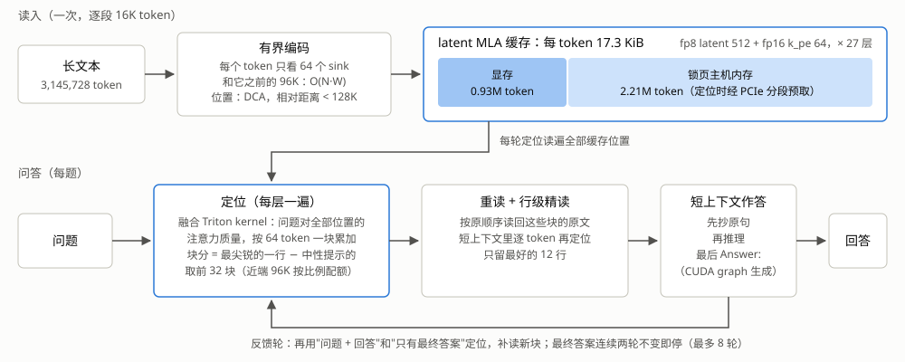
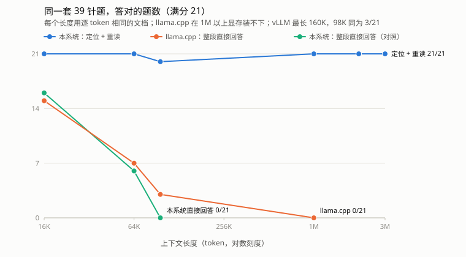
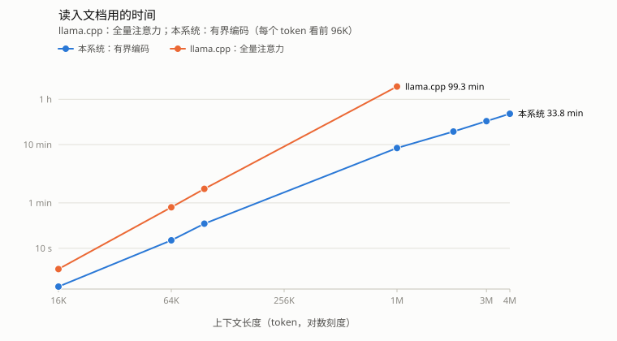

# 单卡 3M 上下文：latent MLA 缓存、DCA、有界编码与"定位 + 重读"

**Three Million Tokens on One Consumer GPU: Latent MLA Caching, Dual Chunk Attention, Bounded Encoding and Locate-then-Reread**

---

## 摘要

一个训练到 128K 的模型，在一张 32 GB 的消费级显卡上，能把多长的文档读进去、并且答对里面的细节？
本文报告一个不做任何训练的系统：DeepSeek-Coder-V2-Lite-Instruct（16B MoE、每 token 激活 2.4B、
MLA 注意力，Q4_K_M 量化 10.4 GB）在单张 RTX 4080 SUPER（32 GB）上读入 **3,145,728 个 token**，
在一套 RULER 式的复杂大海寻针上——39 根针同时在场，16 个相似键、一键多值、一问多键、5 环变量链带干扰链、
两跳——**21 题全对、31 个条目全对，33 处证据全部定位到**；读入 25.3 分钟，21 题共 14.6 分钟，
从头重跑一遍，每一轮的回答逐字相同。

做到这一点靠四件事：（1）**latent MLA 缓存**：只存共享的 512 维 latent 和 64 维 k_pe，fp8 下每 token
17.3 KiB，比展开的逐头 K/V 小 19 倍，放不进显存的部分放锁页主机内存；（2）**DCA**（dual chunk attention）
让任意相对距离都落在训练范围内；（3）**有界编码**：读入时每个 token 只看 64 个 sink 和它之前的 96K，
缓存里的每个条目都在训练分布内算出，prefill 从平方变成线性；（4）**定位 + 重读**：问题用模型自己的注意力
对全部缓存位置打分，读回最相关的原文、在短上下文里作答，多跳问题用回答反馈多轮定位。

在同一台机器、同一个模型、逐 token 相同的文档上，我们与 llama.cpp 和 vLLM 做了对比。**3M 上只有本系统跑得起来**：
llama.cpp 用同一个 GGUF 时 KV 每 token 270 KiB，3M 需要 810 GiB；把同一份权重改写成它的 MLA 布局后，
最省的 q8_0 缓存仍需 48.4 GiB，超过 32 GB 显存，它最长到 1M；vLLM 的 KV 最多放 59.5 万个 token，而且它只为这个模型
预先算了 163,840 个位置的旋转编码表，更长的输入直接让它崩溃。在它们跑得起来的长度上，
"整段直接回答"的正确率随长度下降：llama.cpp 16K 15/21、64K 7/21、98K 3/21、1M 0/21（输出退化成乱码），vLLM 98K 3/21；
本系统换成同样的整段直接回答，16K、64K、98K 是 16、6、0 题，与 llama.cpp 几乎相同——差距来自方法，不是引擎实现；
用"定位 + 重读"，98K 20/21，16K、64K、1M、2M 与 3M 都是 21/21。

我们同时说明这套方法的边界：它测的是检索，不是对整篇文档的综合推理；测试集是合成的；
变量链一题依赖针对任务的指令，作答仍会摇摆。

**关键词**：长上下文；KV 缓存；多头潜在注意力（MLA）；位置外推；大海寻针；单卡推理

---

## Abstract

How long a document can a model trained to 128K tokens read on one 32 GB consumer GPU, and still answer
questions about its details? We report a training-free system in which DeepSeek-Coder-V2-Lite-Instruct
(16B MoE, 2.4B active parameters per token, multi-head latent attention, Q4_K_M, 10.4 GB) reads
**3,145,728 tokens** on a single RTX 4080 SUPER and answers a RULER-style needle suite with 39 needles
present at once — 16 similar keys, one key with many values, many keys in one question, a 5-hop variable
chain next to a distractor chain, and two-hop questions — **21/21 questions and 31/31 items correct, all 33 needle positions located**. Reading takes 25.3 minutes, the 21 questions 14.6 minutes, and a fresh
run reproduces every answer word for word.

Four parts make this possible: (1) a **latent MLA cache** that stores only the shared 512-dim latent and the
64-dim rotary key (17.3 KiB per token in fp8, 19× smaller than expanded per-head K/V), with the part that
does not fit in VRAM kept in pinned host memory; (2) **dual chunk attention**, which keeps every relative
distance inside the trained range; (3) **bounded encoding**: while reading, each token attends to 64 sink
tokens and the previous 96K, so every cache entry is computed in distribution and prefill becomes linear;
(4) **locate-then-reread**: the question scores all cached positions with the model's own attention, the
most relevant original text is read back into a short context, and multi-hop questions feed their
answers into further rounds of locating.

On the same machine, model and token-identical documents we compare with llama.cpp and vLLM. **Only our system runs at 3M**: with the same GGUF, llama.cpp needs 270 KiB of KV per token, 810 GiB for 3M; with the
same weights rewritten into its MLA layout its leanest q8_0 cache still needs 48.4 GiB, more than the GPU
holds, and it tops out at 1M; vLLM fits 595K tokens of KV but precomputes rotary tables for only 163,840
positions of this model, and longer inputs crash it. Where they do run, answering from the whole context degrades
with length (llama.cpp: 15/21 at 16K, 7/21 at 64K, 3/21 at 98K, 0/21 at 1M, where its output degenerates into repeated code fragments;
vLLM: 3/21 at 98K); our engine answering the
same way scores 16, 6 and 0 at 16K, 64K and 98K, close to llama.cpp — the gap comes from the method, not the
engine — while locate-then-reread scores 21/21 at 16K, 64K, 1M, 2M and 3M and 20/21 at 98K. We also state the limits: this is retrieval,
not reasoning over a whole document; the suite is synthetic; the variable-chain question relies on a
task-specific instruction and its answers still waver.

---

## 1. 引言

长上下文的难处在单卡上集中成四道墙。**容量**：KV 缓存随长度线性增长，按常见的逐头布局存，
一个 16B 的 MoE 模型每 token 要 270–324 KiB，32 GB 的显存在 10 万 token 左右就满了。**位置**：
超出训练长度后，旋转位置编码给出模型没见过的相对距离，输出会直接变成乱码。**算力**：全量注意力的
prefill 随长度平方增长，2M token 在这张卡上要两个多小时。**准确**：即使前三道墙都过了，从一百万个
位置里直接"读出"一个七位数，模型也会把相似的事实混在一起、或者抄到一半走样。

主流推理引擎面对的是前两道墙。它们把 KV 整块放在显存里、超出训练长度时沿用 YaRN 等外推，单卡上能开的
上下文被显存直接卡住。本文的问题是：**在一张消费级显卡上、不做任何训练，一个训练到 128K 的模型能把多长的文档完整读进去，并且对其中的细节答对？**

我们的答案是 3M（3,145,728 token），并且是在一套刻意制造混淆的测试上：39 根针同时在同一份文档里，
每根针都是其它针的干扰项。具体贡献：

1. **一套单卡长上下文系统**，把 latent MLA 缓存（显存 + 锁页主机内存两级）、DCA、有界编码和
   "定位 + 重读"组合起来，每一部分对应上面的一道墙（§3）。
2. **按回答反馈的多轮定位**：多跳问题的下一环并不出现在问题里，我们用每轮的回答、以及只用最终答案再定位，
   并给出它在 3M 上为什么必要的诊断（§3.5、§5.4）。
3. **一个融合的定位 kernel** 与配套的工程改动，把 2M 上 21 题的问答时间从 51 分钟降到 8.6 分钟（§3.6、§5.3）。
4. **从 8K 到 3M 的实测**，包括消融、失败案例与原因（§5）；以及与 llama.cpp、vLLM 在逐 token 相同的
   文档上的对比，并用一个"本系统也整段直接回答"的对照把方法与引擎的作用分开（§5.1–§5.2）。
5. 全部代码开源，像 llama.cpp 一样一行安装；`deepinfer-server` 让用户在网页里边读边问，亲手体验
   3M 上下文（§3.7、§5.5）。

---

## 2. 背景与相关工作

### 2.1 KV 缓存与 MLA

DeepSeek-V2 [1] 的多头潜在注意力（MLA）把每个 token 的 K/V 联合压缩成一个 512 维的 latent，
另带一个 64 维、承载位置的旋转键 k_pe。解码时把 K 的上投影吸收进 query、V 的上投影吸收进输出，
16 个头可以直接在共享的 latent 上做注意力 [1, 2]。因此 MLA 真正需要缓存的只有 latent 和 k_pe：
27 层合计每 token 30.4 KiB（fp16）。把它展开成逐头 K/V（每头 192/128 维）再缓存，每 token 就是
270 KiB（f16，llama.cpp 对旧格式 GGUF 的做法）到 324 KiB（补齐到 192 维的分页池）。vLLM [3]、
FlashMLA [2] 与新版 llama.cpp [4] 都已改用 latent 缓存；本文在此基础上把 latent 量化为 fp8
（每 128 维一个 scale，k_pe 保持 fp16，与 FlashMLA 的切法相同），每 token 17.3 KiB。

### 2.2 位置外推

旋转位置编码（RoPE）[5] 在训练长度之外给出未见过的相对位置。位置插值 [6]、YaRN [7]、LongRoPE [8]
通过缩放频率扩展窗口，通常需要少量微调或仍受容量上限约束（本模型的 YaRN 把位置容量扩到 4096 × 40 = 163,840）。
免训练的方法中，Self-Extend [9] 与 DCA [10] 把序列分块、重新映射相对位置，使任意距离都不超出训练范围。
我们采用 DCA：块长取训练长度的 3/4（96K），在训练长度以内与原始 RoPE 逐位相同。

### 2.3 有界注意力与按需检索

StreamingLLM [11] 观察到注意力会大量落在开头的几个 token（attention sink），只保留 sink 加最近窗口
即可无限流式生成，但窗口外的内容随之丢失。另一些工作让 query 只访问少量相关的上下文：Memorizing
Transformers [14] 用 kNN 检索单个键值对，InfLLM [12] 与 Landmark Attention [13] 用块的代表向量或标记 token，
Quest [15] 用每块逐维的最小/最大值给注意力分数一个上界。另一类工作在显存不足时淘汰 KV（H2O [16]、SnapKV [17]）或把 KV 放到主机内存、
按需取回（FlexGen [18]、InfiniGen [19]、ShadowKV [20]）。"检索头"的研究 [21] 发现长上下文里
少数注意力头负责从远处复制事实。

本文的有界编码与 StreamingLLM 同形（sink + 窗口），但只用在**读入**阶段：每个条目都在训练分布内算出，
所有条目都留在缓存里；提问时不受窗口限制。定位用的是**问题自己的、精确归一化的注意力质量**，
对全部位置逐个计算，而不是块的近似表示——我们发现近似检索在 1M 上能找到针、却抄不对数字（§5.4）。

### 2.4 长上下文评测

大海寻针（NIAH）[22] 把一句事实藏进长文档；RULER [23] 把它扩展为多键、多值、多问、变量追踪等更难的
形式，并指出很多模型的有效长度远小于标称长度。"中间丢失" [24] 描述了位置对检索的影响。
我们的测试集按 RULER 的五类题自写，39 根针同时放在同一份文档里（§4.2）。

---

## 3. 方法



**图 1** 读入一次，问答多次。读入时每个 token 只看 sink 和最近 96K（有界编码，位置用 DCA），
写进两级的 latent 缓存；每个问题先在**全部**缓存位置上定位，读回原文、精读到 12 行，在短上下文里作答，
多跳问题用回答反馈再定位。

### 3.1 latent MLA 缓存与两级存储

每层每 token 存两样：`kv_a_layernorm` 之后的 512 维 latent `c`，和已旋转的 64 维 `k_pe`。

| 布局（27 层） | 每 token | 1M | 2M | 3M |
|---|---:|---:|---:|---:|
| 逐头展开、补齐到 192 维（仓库原分页池） | 324.0 KiB | 324 GiB | 648 GiB | 972 GiB |
| 逐头展开 f16（llama.cpp 读旧格式 GGUF） | 270.0 KiB | 270 GiB | 540 GiB | 810 GiB |
| latent fp16 | 30.4 KiB | 30.4 GiB | 60.8 GiB | 91.1 GiB |
| **latent fp8 e4m3（每 128 维一个 fp32 scale）+ k_pe fp16** | **17.3 KiB** | **17.3 GiB** | **34.6 GiB** | **51.9 GiB** |

超出显存预算的部分放在锁页主机内存。3M 时 93 万 token 在显存、221 万在主机内存；PyTorch 把锁页分配
取整到 2 的幂，主机端实占 42 GiB，容器 62 GiB 的上限里用到 58 GB。缓存可以存盘、加载
（2M 的 34.6 GiB 分到两块盘，加载 51 秒，对比重新读入 16.8 分钟），也支持把一段文本插入到指定的逻辑位置。

**prefill** 用展开形式：对每个 query 块，按 tile 从缓存取 latent、用 `kv_b_proj` 展开成逐头 K/V，
跑 FlashAttention-2 [25]（本卡实测 97–102 TFLOPS），各 tile 按 log-sum-exp 合并。没有 FlashAttention
的平台（PyTorch 的 Windows 版）自动换成 memory-efficient kernel，结果与定义一致。**decode** 用吸收形式，
一个 Triton kernel 让 16 个头在 latent 上共享一次读取。

### 3.2 位置：DCA

训练长度之外，DCA [10] 让 key 按 `j mod chunk` 旋转，query 根据 key 在同块、前一块还是更早，
选三种旋转之一，使任何相对距离都小于训练长度，而每个 token 仍在注意力里。chunk 取训练长度的 3/4（96K）。
三种旋转对应三组 query，按区段分别算再按 LSE 合并，算力不增加。旋转角在 fp64 下按需计算
（官方实现每层缓存一份 cos/sin，2M 时 27 层共 13.8 GiB，且角度在 fp32 里形成，2M 处误差约 0.06 rad）。
在训练长度以内 DCA 与原始 RoPE 逐位相同（单元测试逐对验证）。

### 3.3 有界编码

读入（prefill 与插入）时每个 token 只看前 64 个位置（sink）和它之前的 W 个 token；提问不受限制。
W = 96K 时最大相对距离约 114K，全部在训练范围内。它有两个作用：

- **条目质量**：全量注意力读入时，128K 之后每个 token 的 KV 都在超出训练分布的注意力下算出；
  有界编码下所有条目都在分布内（§5.4 的对照显示这直接改善检索）。
- **线性 prefill**：从 O(N²) 变成 O(N·W)。1M 的读入从 35.1 分钟降到 8.9 分钟；窗口缩到 16K，
  2M 的读入从 16.8 分钟降到 6.8 分钟，答题结果不变（§5.3）。

代价是相隔超过 W 的两段文字在编码时互相看不到，跨段的依赖要靠提问时的定位把两段一起读回来。

### 3.4 定位 + 重读

问题对**全部**缓存位置逐层计算精确的、归一化的注意力质量，按 64 token 一块累加，sink 不参与打分；
取最重的块及其邻块，按原顺序把这些块的**原文 token** 拼成一份短文档，在新的短上下文里作答。
在 1M 的单针测试上，这比让问题直接对 100 万个 key 做全量注意力好得多：后者模型能把注意力指向正确的位置，
却从远处抄写七位数时走样（§5.4）。

在 39 根针同时存在的测试上，我们又做了四处改动，每一处都对应一次失败与一次区分实验（§5.4）：

1. **块分取最尖锐的一行，再减去中性提示的。** 把所有层、头、问题 token 的质量求和，会被按位置分配质量的
   多数头淹没；改为每块取（问题 token × 头）中最大的一行，再减去一句中性提示（"Summarize the text above
   in one sentence."）在同一块上的值。
2. **近端配额。** DCA 的同块与相邻块区域注意力天然偏高，最近 96K 按长度占比分配名额（至少 1/8），
   其余名额在更早的部分里排。
3. **行级精读。** 读回的短文档里仍有大量相似的针；在短上下文里（注意力回到训练范围内）把问题再定位一次、
   逐 token 打分，只留最好的 12 行，按原顺序交给模型。
4. **作答格式**：先逐字抄下需要的行，再逐步推理，最后写 `Answer:`（预算 1024 token）。评分只看最后一个
   `Answer:` 之后的内容。

### 3.5 按回答反馈的多轮定位

两跳题与变量链的下一环不出现在问题里（链上的下一个变量名、持钥匙的人）。每一轮的回答（最后 256 token）
连同问题一起再定位一次，补读 8 个新块；此外**只用 "Answer: <最终答案>"** 再定位一次、补读 32 个块，
交给行级精读去挑行。最终答案（`Answer:` 之后的数字或全大写标识符）连续两轮不变即停，最多 8 轮。

第二种定位在 3M 上是必要的：§5.4 的诊断显示，变量链下一环所在的块在未读块里，用"问题 + 整段回答"定位时
排第 154、241 名，用"问题 + 最终答案"排第 25–121 名，只用最终答案排第 5–26 名。变量链一题另用三种问法各答一次、取名字的并集（self-consistency），
指令要求按顺序模拟赋值、只看 `VAR` 行（与 RULER 为该类题给的模板一致）；这两点是针对这类题的，我们在 §6 说明。

### 3.6 让它在单卡上跑得动

- **融合定位 kernel。** 原来每层要把缓存读三遍（问题的注意力、块的 log-sum-exp、块质量），2M 时一半以上的
  缓存在主机内存，每一遍都过 PCIe。现在一个 Triton kernel 计算吸收形式的分数 `q_abs·c + q_pe·k_pe`，
  同一组概率既给出每块的 log 质量、也更新 flash 注意力的累加；fp8 缓存段整体反量化一次；主机内存的段在另一个
  CUDA stream 上提前拷入（分配暂存区后先让拷贝 stream 等一次计算 stream，否则缓存分配器会复用仍在使用的
  显存，2M 上整层输出变成 NaN）。2M 上问题本身的定位从 17.4 s 降到 2.5–2.8 s，带 274 个回答 token 的从
  62.8 s 降到 13.4–13.9 s。
- **MoE 读入用常驻专家 + 张量核。** 读入时把该层用到的专家从显存里的打包权重反量化成 fp16、每个专家三次
  cuBLAS GEMM：16K token 每层 69–81 ms，原来的融合分组 kernel 要 1,150 ms。按专家依次累加输出，
  去掉了原子加法的次序不定，整条流水线从此是确定的。
- **作答用 CUDA graph。** 作答的上下文只有几百到两千个位置，一步解码可以完全不回主机：嵌入表在显存，
  门控的 top-k 直接索引常驻专家的指针表，整步录成一个 graph 重放，每 8 步回主机看一次停止符。
  每 token 从 55–136 ms 降到 14–20 ms。

### 3.7 服务形态

`deepinfer-server` 是一个边读边问的服务：一个工作线程独占 GPU，文本按 16K token 一段编码，两段之间先处理
排队的问题——提问优先于下一段读入，所以上下文还在长的时候就能问已经读进去的部分；回答逐字流出，同时推送
每轮定位读回的块和答案依据的行在整条上下文里的位置。整个系统可以像 llama.cpp 一样一行安装
（`deepinfer-cli`、`deepinfer-server`、`deepinfer-bench`，`-m` 本地 GGUF 或 `-hf` 下载）。

---

## 4. 实验设置

### 4.1 硬件与模型

- **GPU**：RTX 4080 SUPER，32 GB（31.47 GiB 可用），sm_89，PCIe 4.0 ×8（实测约 13 GB/s）。
- **主机**：AutoDL 容器，内存上限 62 GiB，16 个 CPU 核可用；驱动 580（CUDA 13.0），PyTorch 2.5.1 + CUDA 12.4。
- **模型**：DeepSeek-Coder-V2-Lite-Instruct [26]，Q4_K_M GGUF（second-state，10.4 GB，sha256 `38bc76f3…`），
  训练长度 128K（YaRN 40 倍，位置容量 163,840）。没有任何微调。

### 4.2 测试集

**单针（S1）**：每根针是真实文本里的一句不同事实（"Dr. Amber Lynx 把研究笔记放在 7624039 号柜"之类），
答案为 7 位数，9 根针放在 0–99% 的不同深度。

**复杂多针（S2，RULER 式）**：同一份文档里同时放 39 根针，一次读入，问 21 题、共 31 个条目：

| 类型 | 内容 | 题数 | 条目 |
|---|---|---:|---:|
| MK 多键 | 16 条同模板事实 "The special magic number for <key> is: <7 位数>."，键共享单词（crimson falcon / crimson otter / silver otter …） | 16 | 16 |
| MV 多值 | 一个键 4 个值散在 4 处，旁有近似键 | 1 | 4 |
| MQ 多问 | 一个问题同时问 4 个键 | 1 | 4 |
| VT 变量追踪 | `VAR GHTAY = 14673`、`VAR OKOSG = VAR GHTAY` … 5 环链，旁有 4 环干扰链；答出干扰链即错 | 1 | 5 |
| 2H 两跳 | "某天文台的钥匙由 Kaila Brenn 保管" 与远处 "Kaila Brenn 的工牌号是 …"，旁有干扰号码 | 2 | 2 |

草堆是 CPython 3.12 标准库源码（按文件名排序，确定性），针放在固定深度；随机种子 11。
同一长度下各引擎拿到的是**逐 token 相同**的文档（记录了 token 序列的 sha256）。评分只看最后一个 `Answer:`
之后的内容：单答案题必须恰好给出正确的码，列表题必须包含全部条目，混入干扰项即错。

### 4.3 对比对象

- **llama.cpp** b12024（提交 ddf48f8，CUDA、sm_89 编译）的 `llama-server`，整个模型放在 GPU 上。
  用同一个 GGUF 时，FlashAttention 对这份文件的头维度（192/128）回落到 CPU（prefill 188 tok/s），
  所以用它最快的 GPU 配置：关闭 FlashAttention、K 缓存 q8_0（8,335 tok/s）。我们还用
  `scripts/gguf_mla_layout.py` 把**同一份权重**改写成 llama.cpp 的 MLA 布局（只拆分 `attn_kv_b`，
  其余张量逐字节复制），这是它最省显存的形态：FlashAttention 开启、K/V 缓存 q8_0（8,582 tok/s）。
  `llama-server` 默认把单个槽位的上下文截到训练长度 163,840，我们用 `--override-kv` 解除这一限制
  （YaRN 的基准长度取自另一个字段，位置计算不变）。
- **vLLM**：最新的 0.32 已不能加载 GGUF，且它需要的 PyTorch 2.13 整套超出了机器的剩余磁盘，所以用
  能与机器上 PyTorch 2.5.1 共存的 0.7.3，模型用同一个模型的 AWQ 4-bit 版本 [27]（TechxGenus）。
  上下文超过 32K 时 vLLM 0.7.3 默认开启分块读入、单批 2,048 token；检测到 MLA 后它又强制关闭分块读入（连同前缀缓存），
  单批上限却仍是 2,048——于是任何超过 2,048 token 的提问都被调度器直接丢弃（"Input prompt … exceeds limit of 2048"），
  第一次运行 21 题的回答全是空的。我们把 `--max-num-batched-tokens` 设成不小于提问长度，让整段提问一次读入后重测；
  被丢弃的那次运行保留为 `vllm_98k_rejected.*`，不计成绩。
- 对比对象都用服务引擎的标准方式作答：把文档和问题一起交给模型、全量注意力、贪心解码、最多 1024 个新 token，
  指令与评分与本系统完全相同，变量链同样三种问法取并集；文档作为前缀缓存，只有第一个请求真正读入全文
  （vLLM 0.7.3 在 MLA 下没有前缀缓存，每题都重新读入全文，答案不受影响）。
- **对照**：本系统也用同样的"整段直接回答"（不定位、全量注意力、每题之后把缓存退回），以区分方法与引擎。

---

## 5. 结果

### 5.1 3M 能不能装下

| 引擎 | 每 token 的 KV | 3M 需要 | 在这台机器上最长 | 3M |
|---|---:|---:|---:|---|
| **本系统**（latent fp8，显存 + 锁页主机内存） | **17.3 KiB** | **51.9 GiB**（显存 15.4 GiB + 主机 36.5 GiB） | **3.41M**（服务的容量） | **跑通：读入 25.3 min，21/21** |
| llama.cpp，同一个 GGUF（逐头展开，K q8_0） | 194 KiB | 582 GiB | 98K | `cudaMalloc` 失败 |
| llama.cpp，同一个 GGUF（f16） | 270 KiB | 810 GiB | 64K | `cudaMalloc` 失败 |
| llama.cpp，MLA 布局（f16） | 30.4 KiB | 91.1 GiB | 512K | `cudaMalloc` 失败 |
| llama.cpp，MLA 布局（q8_0） | 16.1 KiB | 48.4 GiB | **1M** | `cudaMalloc` 失败 |
| vLLM 0.7.3（AWQ） | 约 33.9 KiB | 约 102 GiB | 163,840（位置表上限） | 启动即报错 |

vLLM 有两道限制（`baselines/vllm_*.server.log`）：KV 只能放在显存里，19.24 GiB 放得下 595,248 个 token，3M 与 1M
在启动时就被它自己的容量检查拒绝；更早碰到的是位置——它为 DeepSeek 的 YaRN 只预先算了 4,096 × 40 = 163,840 行
cos/sin 表，读入时按位置直接查表，所以 256K、512K 一启动（试跑一批同样长的输入）就触发越界断言（`index out of bounds`）。
它在这台机器、这个模型上的实际上限就是 163,840。

llama.cpp 的 MLA 布局在 q8_0 下每 token 16.1 KiB，与本系统的 fp8 latent（17.3 KiB）几乎一样省——
**差别不在压缩，而在放在哪里**：它要求整个序列的 KV 都在显存里，32 GB 减去 10 GB 的权重，最多放下 1M；
本系统把放不下的 221 万 token 放进锁页主机内存，定位时分段经 PCIe 读回（§3.1、§3.6）。

### 5.2 准确率随长度的变化



**图 2** 同一套 39 针题、逐 token 相同的文档上，21 题全对的题数随上下文长度的变化（横轴对数）。llama.cpp 在 1M 以上显存装不下；本系统整段直接回答（对照）测了 16K–98K。

| 长度 | llama.cpp 整段直接回答 | 本系统整段直接回答（对照） | **本系统 定位 + 重读** |
|---:|---:|---:|---:|
| 16K | 15/21（23/31） | 16/21（24/31） | **21/21（31/31）** |
| 64K | 7/21（13/31） | 6/21（14/31） | **21/21（31/31）** |
| 98K | 3/21（9/31） | 0/21（1/31） | **20/21（30/31）** |
| 1M | 0/21（0/31，输出退化成乱码；MLA 布局） | — | **21/21（31/31）** |
| 2M | 装不下 | — | **21/21（31/31）** |
| 3M | 装不下 | — | **21/21（31/31）** |

（98K 是 llama.cpp 用原 GGUF 的上限，1M 是 MLA 布局的上限。vLLM 0.7.3 用同一模型的 AWQ 版，98K 整段直接回答
3/21（6/31），与 llama.cpp 相同。）

四点观察：

1. **整段直接回答随长度变差**，而且引擎之间一致：llama.cpp 16K、64K、98K 是 15、7、3 题，本系统换成同样的
   答法是 16、6、0 题，vLLM 在 98K 也是 3 题。错法也一样——答出的是文档里**别的针**的码（98K 上 llama.cpp 与 vLLM
   各把一个号码答给了 7 个不同的键），是相似事实之间的混淆，不是找不到。所以低分不是哪个引擎的实现问题，差距来自方法。
2. **定位 + 重读不随长度变差**：16K、64K、1M、2M、3M 都是 21/21，98K 20/21。错的那一题是变量链（5 个名字答出 4 个）。
3. **超出位置容量后，整段直接回答连格式都保不住**：llama.cpp 在 1M 上 21 题的输出全部退化成重复的代码片段
   （`res = if res = …`），一个条目也没有答对。这个模型的 YaRN 只覆盖 163,840 个位置，与 §5.4 中原始 RoPE 在 256K
   输出乱码是同一现象；本系统用 DCA 把所有相对距离留在训练范围内。
4. 这与我们在单针测试上的观察一致（§5.4）：模型的注意力在超长上下文里仍能**指向**正确的位置，
   但从大量相似内容里直接**读出**细节会出错；把相关的原文读回到一个短上下文里，问题就回到了模型擅长的范围。

### 5.3 速度

| 长度 | llama.cpp 读入 | 本系统读入（96K 窗口） | 本系统读入（16K 窗口） |
|---:|---:|---:|---:|
| 16K | 4.4 s | 2.2 s | |
| 64K | 50.5 s | 13.7 s | |
| 98K | 104.5 s | 26.4 s | |
| 1M | 99.3 min | 8.7 min | |
| 2M | 装不下 | 16.8 min | 6.8 min |
| 3M | 装不下 | 25.3 min | |



**图 3** 读入文档用的时间（双对数）。llama.cpp 用全量注意力，随长度平方增长（1M 99.3 分钟）；本系统用有界编码，随长度线性增长（1M 8.7 分钟，3M 25.3 分钟）。

llama.cpp 用全量注意力读入，时间随长度平方增长；本系统的有界编码随长度线性增长。问答方面，本系统每题要定位
（可能多轮）、精读再作答：3M 上 21 题共 14.6 分钟、2M 上 8.6 分钟（每题中位 18 s），比整段直接回答慢
（llama.cpp 98K 上 21 题共 213 s），换来的是答对。2M 上问答的加速来自 §3.6 的三处改动：

| 一轮里的环节（2M） | 原来 | 现在 |
|---|---:|---:|
| 定位：问题本身（17 token） | 17.4 s | 2.5–2.8 s |
| 定位：问题 + 上一轮回答（274 token） | 62.8 s | 13.4–13.9 s |
| 精读（7.7K → 162 token） | 4.0–7.0 s | 1.6–2.6 s |
| 生成 | 55–136 ms/token | 14–20 ms/token |
| **21 题合计** | **51.2 min** | **8.6 min** |

### 5.4 消融与诊断

**位置编码**（S1，256K）：原始 RoPE（YaRN 40 倍）0/3，输出是乱码（`'can = name = _find = None = …'`）；DCA 3/3。

**全量注意力 vs 定位**（S1，1M，同一份缓存）：

| 提问方式 | 定位到 | 答对 | 现象 |
|---|---:|---:|---|
| 问题直接全量注意力 | — | 2/9 | 只有最后约 100K 内的针答对 |
| 全量 + log-n 缩放 / 改 DCA 远距上限 | — | 0–1/9 | 更差 |
| 块检索 top-64（Quest 式上界） | ~8/9 | 2/9 | 找对了针，七位数抄到一半走样 |
| **定位 + 重读 top-32** | **9/9** | **9/9** | 深度 4 到 1,038,097 全中 |

**有界编码**（S1，1M）：全量注意力读入 35.1 分钟、有界编码 8.9 分钟；在有界编码的缓存上，块检索从 2/9
升到 4/9（错的多是差一位），定位 + 重读 top-8 从 8/9 升到 9/9——缓存条目确实被全量读入"弄坏"了。

**块打分**（S2，相关针的块排进前 32 的比例）：

| 打分 | 256K | 2M |
|---|---:|---:|
| 所有层、头、问题 token 求和 | 16/33 | 1/33 |
| 最尖锐的一行 | 31/33 | 22/33 |
| **最尖锐的一行 − 中性提示** | **31/33** | **29/33** |

**行级精读**（S2，256K 单轮）：MK 14/16 → 15/16，两跳第二题从选错人到选对人。

**只用最终答案再定位**（S2，3M，变量链每一跳"下一环"所在块在未读块里的排名）：

| 下一环 | 问题 + 整段回答 | 问题 + 最终答案 | 只有最终答案 |
|---|---:|---:|---:|
| 第 1 跳 | 154、241（两版回答） | 76 | 14 |
| 第 2 跳 | — | 121 | 22 |
| 第 3 跳 | — | 25 | 5 |
| 第 4 跳 | — | 62 | 26 |

2M 上"只有最终答案"把下一环排在第 0–1 名；到 3M（4.9 万个块）仍能排进前 30、但进不了前 8。补读 32 个块后，
3M 从 20/21（变量链停在链头）变为 21/21。

**编码窗口**（S2，2M）：96K → 16K，读入 16.8 → 6.8 分钟；两次 16K 运行分别 20/21、21/21，33 处针都定位到，
错的仍是变量链（与 96K 下变量链的摇摆相当）。

### 5.5 边读边问

同一个服务从空读到 3M，问题夹在读入中间（与 §5.2 同一份文档，读入约 2,000 token/s）：

| 时机 | 当时的上下文 | 问题 | 首字 | 全程 | 结果 |
|---|---:|---|---:|---:|---|
| 读入中 | 229,380 | jade panther 的号码 | 2.8 s | 10.0 s | ✓ |
| 读入中 | 2,752,545 | ivory mantis 的号码（针在 94.7% 深处） | 8.4 s | 39.6 s | ✓ |
| 读入中 | 3,113,022 | 两跳：依据分别在 2.0% 与 91.4% 处，相距 278 万 token | 9.5 s | 31.6 s | ✓ |
| 读完 | 3,145,728 | 变量链（评测时的指令、最多 8 轮、三种问法取并） | 11.1 s | 274.6 s | ✓ 5 个名字 |
| 读完 | 3,145,792 | 换个说法问 onyx badger 的号码（通用指令） | 9.8 s | 36.5 s | ✓ |
| 读完 | 3,145,826 | "我问的第一个问题是什么、你怎么答的" | 9.6 s | 49.9 s | ✓ |

### 5.6 正确性与复现

- **逐 logit 对照**：在 1,486 token 的真实提示上，与运行时参考实现相比，fp16 余弦 0.999995、fp8 latent 0.999980，
  贪心输出逐 token 相同；主机内存分层、分块 prefill、DCA（训练长度以内）均与参考一致。
- **独立实现交叉验证**：32K、9 根同模板的针，llama.cpp 与本系统逐题答案相同（都是同样 3 题答成同一个码）。
- **确定性**：3M 上从头重新读入、用另一个进程重跑，21 题每一轮的回答逐字相同。
- **单元测试**：DCA 在训练长度内逐对精确、超出后所有距离都小于训练长度；prefill 与 decode 对逐 (i, j) 的直接定义；
  定位 kernel 的块质量等于逐 (query, head) softmax 求和（fp8/fp16、显存/主机分界、多种 DCA 关系）。

---

## 6. 讨论与局限

**为什么直接读不行、定位行。** 超出训练长度后，模型的注意力仍能把质量集中到正确的位置（定位 9/9），
但要从一百万个 key 里逐字抄出一个七位数，相似内容的干扰和远距离的数值误差会让它走样；
同样的事实放进几千 token 的短上下文，抄写是全对的。有界编码进一步保证缓存里的每个条目都在训练分布内算出。
这与"检索头"的观察 [21] 相容：远处的事实由少数头负责取回，我们的块打分正是去找这些最尖锐的行。

**测的是检索，不是综合推理。** 针是一句话的事实；需要综合整篇文档的问题（汇总、计数，如 RULER 的 CWE/FWE、
LongBench）没有测。定位 + 重读只读回少数几块原文，对这类问题是否够用是开放的问题；有界编码下相隔超过 96K
的两段文字在读入时互相看不到，跨段依赖只能靠提问时的定位一起读回。

**变量链一题依赖针对任务的指令，作答仍会摇摆。** 指令要求按顺序模拟赋值、只看 `VAR` 行，并对三种问法取并集；
在 9 行干净文本上，模型对"反向找链"的 8 种问法全部答错，所以这不是长上下文的问题。多次运行里，这一题在
2M 上有两次是停在轮数上限时恰好答对。

**测试集是合成的，针是我们写的**；草堆是代码，自然语言的针在里面比较显眼。题型少于 RULER。

**对比的公平性。** llama.cpp 用了它在这份文件上最快的 GPU 配置，并在同一份权重的 MLA 布局上再测一次，
解除了服务端的训练长度上限——这些都是为了让它跑得更长，而不是更短。vLLM 不是最新版本，模型是同一模型的
AWQ 版本而非同一个文件；它要求整个序列的 KV 都在显存里，这一点各版本相同。整段直接回答是服务引擎的标准用法，
不是它们能力的上限：在它们之上也可以实现定位 + 重读，但需要的是能访问全部 KV 的注意力打分与超出显存的缓存，
而这正是本文的系统部分。

**单卡、单模型、单请求。** 只测了 DeepSeek-V2 系列的 MLA 模型和一种显卡；服务一次只答一个问题。
4M 需要约 69 GiB 的 KV，主机端锁页约 54 GiB，PyTorch 把锁页分配取整到 2 的幂后超过容器上限，需要按实际大小锁页。

---

## 7. 结论

在一张 32 GB 的消费级显卡上，不做任何训练，一个训练到 128K 的 MoE 模型读入了 3,145,728 个 token，
并在 39 根针同时存在的测试上答对了全部 21 题、31 个条目。latent fp8 缓存加锁页主机内存解决容量，
DCA 解决位置，有界编码让读入线性且条目都在分布内，定位 + 重读与按回答反馈的多轮定位解决准确。
同一台机器上，llama.cpp 与 vLLM 都装不下 3M；在它们装得下的长度上，整段直接回答随长度变差，
而定位 + 重读不变——本系统换成同样的答法也一样变差（16K、64K、98K 分别 16、6、0 题；llama.cpp 15、7、3 题；
vLLM 98K 3 题），说明差距来自方法。

---

## 附录 A：复现命令

```bash
# 安装（Linux / WSL）
curl -fsSL https://raw.githubusercontent.com/umouyoumou-del/DeepInfer-SM86/main/install.sh | sh

# 3M 复杂多针，读入 + 21 题（结果 docs/results/longctx/complex_3m_v4.json）
python scripts/needle_complex.py --tokens 3145728 --near-window 98304 --out complex_3m.json

# 同一份文档，本系统整段直接回答（对照）
python scripts/needle_complex.py --tokens 98304 --near-window 98304 --mode plain --out plain_96k.json

# 同一份文档交给 llama.cpp / vLLM（先启动它们的服务）
python scripts/longctx_baseline.py --engine llama.cpp --url http://127.0.0.1:8090 --tokens 98304 --out llama_98k.json
python scripts/longctx_baseline.py --engine vllm --url http://127.0.0.1:8000 --model coder --tokens 98304 --out vllm_98k.json

# 把旧格式的 DeepSeek-V2 GGUF 改写成 llama.cpp 的 MLA 布局（权重不变）
python scripts/gguf_mla_layout.py old.gguf new.gguf --gguf-py llama.cpp/gguf-py

# 边读边问的网页
deepinfer-server -hf coder -c 3407872 --host 0.0.0.0 --port 6006
```

## 附录 B：结果文件

- `docs/results/longctx/needle_*.json`：单针（S1）各长度、各方式。
- `docs/results/longctx/complex_*.json`：复杂多针（S2），每题每一轮读回的块、精读留下的行与回答。
  3M：`complex_3m_v3.json`、`complex_3m_v3b.json`（同一缓存重跑）、`complex_3m_v4.json`（从头重跑）。
- `docs/results/longctx/baselines/`：与 llama.cpp、vLLM 的对比与对照运行，以及各引擎的容量探测日志。
- 过程记录：`docs/LONG_CONTEXT_1M.md`。

## 参考文献

1. DeepSeek-AI. *DeepSeek-V2: A Strong, Economical, and Efficient Mixture-of-Experts Language Model.* arXiv:2405.04434, 2024.
2. DeepSeek-AI. *FlashMLA: Efficient MLA decoding kernels.* GitHub, 2025.
3. Kwon W., et al. *Efficient Memory Management for Large Language Model Serving with PagedAttention.* SOSP, 2023.
4. Gerganov G., et al. *llama.cpp.* GitHub.
5. Su J., et al. *RoFormer: Enhanced Transformer with Rotary Position Embedding.* Neurocomputing, 2024.
6. Chen S., et al. *Extending Context Window of Large Language Models via Positional Interpolation.* arXiv:2306.15595, 2023.
7. Peng B., et al. *YaRN: Efficient Context Window Extension of Large Language Models.* ICLR, 2024.
8. Ding Y., et al. *LongRoPE: Extending LLM Context Window Beyond 2 Million Tokens.* ICML, 2024.
9. Jin H., et al. *LLM Maybe LongLM: Self-Extend LLM Context Window Without Tuning.* ICML, 2024.
10. An C., et al. *Training-Free Long-Context Scaling of Large Language Models.* ICML, 2024.
11. Xiao G., et al. *Efficient Streaming Language Models with Attention Sinks.* ICLR, 2024.
12. Xiao C., et al. *InfLLM: Training-Free Long-Context Extrapolation for LLMs with an Efficient Context Memory.* NeurIPS, 2024.
13. Mohtashami A., Jaggi M. *Landmark Attention: Random-Access Infinite Context Length for Transformers.* NeurIPS, 2023.
14. Wu Y., et al. *Memorizing Transformers.* ICLR, 2022.
15. Tang J., et al. *Quest: Query-Aware Sparsity for Efficient Long-Context LLM Inference.* ICML, 2024.
16. Zhang Z., et al. *H2O: Heavy-Hitter Oracle for Efficient Generative Inference of Large Language Models.* NeurIPS, 2023.
17. Li Y., et al. *SnapKV: LLM Knows What You are Looking for Before Generation.* NeurIPS, 2024.
18. Sheng Y., et al. *FlexGen: High-Throughput Generative Inference of Large Language Models with a Single GPU.* ICML, 2023.
19. Lee W., et al. *InfiniGen: Efficient Generative Inference of Large Language Models with Dynamic KV Cache Management.* OSDI, 2024.
20. Sun H., et al. *ShadowKV: KV Cache in Shadows for High-Throughput Long-Context LLM Inference.* arXiv:2410.21465, 2024.
21. Wu W., et al. *Retrieval Head Mechanistically Explains Long-Context Factuality.* arXiv:2404.15574, 2024.
22. Kamradt G. *Needle In A Haystack — Pressure Testing LLMs.* GitHub, 2023.
23. Hsieh C.-P., et al. *RULER: What's the Real Context Size of Your Long-Context Language Models?* COLM, 2024.
24. Liu N. F., et al. *Lost in the Middle: How Language Models Use Long Contexts.* TACL, 2024.
25. Dao T. *FlashAttention-2: Faster Attention with Better Parallelism and Work Partitioning.* ICLR, 2024.
26. DeepSeek-AI. *DeepSeek-Coder-V2: Breaking the Barrier of Closed-Source Models in Code Intelligence.* arXiv:2406.11931, 2024.
27. Lin J., et al. *AWQ: Activation-aware Weight Quantization for LLM Compression and Acceleration.* MLSys, 2024.

> **参考文献核验状态**：以上为通行文献，标题与出处按我们所知列出；会议年份、卷期与作者全名投稿前须逐条核对。
